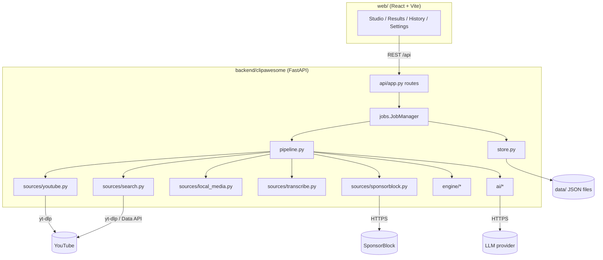

# Architecture

## Overview



## Request lifecycle

1. UI posts an analysis request (`/api/analyze/youtube`, `/api/analyze/local`, `/api/analyze/local-path`, `/api/discover`).
2. The route validates input and submits a job to `JobManager` (thread pool) → returns `{job_id}` immediately.
3. The job runs a pipeline function that reports `(stage, progress)` callbacks.
4. The pipeline builds a `SourceSignals` bundle per video, runs the engine, optionally AI re-ranking, and returns an `Analysis`.
5. `store` persists the `Analysis`; the job records `result_id`.
6. UI polls `/api/jobs/{id}` and navigates to `/analysis/{result_id}` when done.

## Module map (`backend/clipawesome`)

| Module | Responsibility |
|---|---|
| `config.py` | Paths, `Settings` model, load/save, secret masking |
| `models.py` | Pydantic models shared by API and pipeline (`Analysis`, `ClipSuggestion`, `SourceVideo`, `Timeline`, requests, jobs) |
| `text.py` | Tokeniser, stop-words, stemmer, BM25, keyword extraction |
| `transcript.py` | Parsers (json3, vtt, srt), `Word`/`Sentence`/`Event` types, sentence segmentation, reaction tags |
| `engine/signals.py` | `SourceSignals` bundle → per-second normalised series |
| `engine/scoring.py` | Candidate windows, window features, penalties, NMS, padding, breakdown, reasons |
| `engine/presets.py` | Length presets |
| `sources/youtube.py` | URL validation, yt-dlp metadata, captions, comments, temporary audio download |
| `sources/sponsorblock.py` | SponsorBlock segments |
| `sources/local_media.py` | PyAV probe, loudness, scene cuts |
| `sources/transcribe.py` | faster-whisper wrapper with model cache |
| `sources/search.py` | yt-dlp search, YouTube Data API search, video ranking |
| `ai/llm.py` | OpenAI-SDK chat client for every provider (custom / Gemini / Groq / NVIDIA NIM); JSON replies, param relaxation, `<think>` stripping, model listing |
| `ai/rerank.py` | Clip re-ranking, topic expansion, video re-ranking prompts |
| `pipeline.py` | Orchestration for youtube / local / discover |
| `jobs.py` | Thread-pool job manager |
| `store.py` | Analyses, history index, media registry |
| `api/app.py` | FastAPI app, routes, CORS, static UI |

## Key design decisions

- **Engine is pure and offline.** It only consumes a `SourceSignals` bundle, which makes it fully unit-testable with synthetic data.
- **AI never produces timestamps.** It selects among engine candidates by ID; boundaries stay sentence-aligned and verifiable.
- **Every signal is optional.** Weights are re-normalised over available signals; missing signals become warnings.
- **No system ffmpeg.** PyAV ships FFmpeg libraries; faster-whisper decodes through PyAV too.
- **Strict YouTube-only URL intake** prevents yt-dlp's generic extractor from fetching arbitrary URLs (SSRF hardening).
- **Local-first.** Data lives in `data/`; the server binds to `127.0.0.1`.

## Data layout (`data/`, git-ignored)

```
data/
  settings.json          # user settings (contains secrets — local only)
  analyses/<id>.json     # full Analysis documents
  analyses/index.json    # history summaries
  media.json             # media registry: media_id -> file path
  uploads/<media_id>.*   # uploaded files
  models/                # Whisper model cache
  tmp/                   # temporary audio downloads (auto-cleaned)
```
