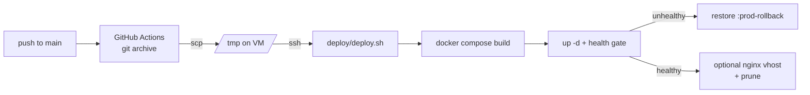

# Deployment

ClipAwesome ships as one Docker container. It runs on the same VM as Robee and joins the nginx container's Docker network. Every push to `main` deploys it. The pipeline does not run tests.



## Files

| File | Purpose |
|---|---|
| [Dockerfile](../Dockerfile) | Stage 1 builds the React UI (Node 24). Stage 2 is Python 3.13 slim with the backend, optional Whisper, and Deno (yt-dlp's YouTube challenge solver). Runs as uid 10001 with a health check on `/api/healthz`. |
| [compose.yaml](../compose.yaml) | Project `clipawesome`, service `app`, image `clipawesome:prod`, volume `clipawesome_data` → `/data`, port `127.0.0.1:8096`, memory/CPU caps |
| [.env.example](../.env.example) | Non-secret settings; the pipeline turns it into `.env` on the VM and appends the auth secrets |
| [deploy/deploy.sh](../deploy/deploy.sh) | Server-side steps: preflight → `.env` → nginx/network detection → build → start → health gate → rollback / vhost → cleanup |
| [deploy/nginx/clipawesome.conf.template](../deploy/nginx/clipawesome.conf.template) | Server block (20 GB uploads streamed, 300 s timeouts) |
| [.github/workflows/deploy.yml](../.github/workflows/deploy.yml) | Runs on push to `main` or manually (`workflow_dispatch`) |

## One-time GitHub setup

**Settings → Secrets and variables → Actions**

| Kind | Name | Required | Value |
|---|---|---|---|
| Secret | `VM_HOST_R`, `VM_USERNAME_R`, `VM_SSH_KEY_R`, `VM_PORT_R` | yes | Same values as the Robee repo (same VM) |
| Secret | `CLIPAWESOME_AUTH_PASSWORD` | yes | Password for the browser login. Must not contain `'`. The deploy fails if it is missing. |
| Secret | `CLIPAWESOME_AUTH_USER` | no | Login user (default `admin`) |
| Variable | `CLIPAWESOME_DOMAIN` | no | e.g. `clips.example.com`. When set, the pipeline installs an nginx vhost for it. |
| Variable | `NGINX_CONTAINER` | no | Name of the nginx container, if auto-detection picks the wrong one |
| Variable | `NGINX_NETWORK` | no | Docker network to share with nginx, if auto-detection picks the wrong one |

The SSH user must be able to run `docker` without sudo, which Robee already requires. Docker Compose v2 is required. The VM needs at least 4 GB free disk and at least 2 CPUs, or lower `CLIPAWESOME_CPUS` in `.env.example`.

## How it connects to nginx

`deploy.sh` detects nginx on every deploy:

1. **nginx in a container** (any running container whose name or image contains `nginx`, or `NGINX_CONTAINER`): the script reads that container's user-defined network and writes `compose.proxy.yaml`. That override attaches `app` to the network under the alias **`clipawesome`**, so nginx can reach it at `http://clipawesome:8765`. The default `bridge` network can't resolve container names; in that case set `NGINX_NETWORK`.
2. **nginx in a container with host networking**, or **nginx on the host** (`systemctl is-active nginx`): the upstream is `http://127.0.0.1:8096`.
3. **No nginx**: the app listens only on `127.0.0.1:8096`. Use `ssh -L 8096:127.0.0.1:8096 user@vm` and open http://localhost:8096.

The port is always bound to loopback, so the app is never exposed on the VM's public interface directly.

### vhost

The pipeline changes nginx config only if `CLIPAWESOME_DOMAIN` is set. Then it:

- renders the template into nginx's `conf.d`. For a container, it uses the host directory mounted at `/etc/nginx/conf.d`, and writes it directly or with passwordless `sudo`.
- runs `nginx -t` and reloads nginx. If the test fails, it restores the previous file and reloads again. A vhost failure never fails the deploy and never affects Robee's config.

The vhost uses a variable upstream with Docker's DNS (`resolver 127.0.0.11`). As a result, nginx still starts and serves Robee even when ClipAwesome is stopped.

To wire it by hand instead, copy the template, replace `__SERVER_NAME__` with your domain, `__PROXY_TARGET__` with `http://clipawesome:8765` (container) or `http://127.0.0.1:8096` (host nginx), and `__RESOLVER__` with `resolver 127.0.0.11 valid=10s ipv6=off;` (container) or an empty string. Then run `nginx -t` and reload.

### HTTPS

The vhost listens on port 80. Basic auth over plain HTTP exposes the password, so put TLS in front before sharing the URL. Use whatever Robee's nginx already uses (certbot, or a wildcard certificate in its `conf.d`), and add a `listen 443 ssl` block for the domain.

## Security defaults in the container

- **Login required.** HTTP Basic auth guards the UI and every API route except `/api/healthz`. Without it, anyone who reached the URL could change the AI base URL and have the server send your stored API key there.
- **No server-path analysis.** `CLIPAWESOME_ALLOW_LOCAL_PATH=false` stops visitors from reading media files off the VM. Uploads still work, and the UI hides the option.
- The app runs as a non-root user. Settings, which include API keys, live only in the `clipawesome_data` volume, never in the image or the repo.

## Operating it on the VM

```bash
cd ~/clipawesome/src
docker compose -p clipawesome ps
docker compose -p clipawesome logs -f app
docker compose -p clipawesome restart app
curl -s http://127.0.0.1:8096/api/healthz
```

Re-run a deploy without pushing: **Actions → Deploy → Run workflow**.

Data such as analyses, uploads, settings, and Whisper models lives in the volume `clipawesome_data`. It survives deploys and rollbacks. Back it up with:

```bash
docker run --rm -v clipawesome_data:/data -v "$PWD":/backup busybox tar czf /backup/clipawesome-data.tgz -C /data .
```

Uploaded videos stay in `/data/uploads` until you delete their analyses in History. YouTube downloads (`/data/downloads`) and Editor uploads/exports (`/data/editor`) are deleted 24 h after finishing (`CLIPAWESOME_DOWNLOAD_TTL_HOURS` in `.env.example`, `0` keeps them). Watch the disk on a shared VM.

## Resource budget

Measured on the dev box:

| | Idle | Whisper `base` | Whisper `small` |
|---|---|---|---|
| RAM | ~100 MB | ~650 MB peak | ~920 MB peak |
| Speed | — | ~8× realtime | ~3.5× realtime |

The default caps are `mem_limit 3g` and `cpus 2`, so a long transcription can't starve Robee. To build a lighter image without Whisper (~150 MB smaller), set `CLIPAWESOME_TRANSCRIBE=false` in `.env.example`.

## Caveats

- **YouTube blocks many datacenter IPs** with "Sign in to confirm you're not a bot". If YouTube analysis fails on the VM but works locally, set a residential or HTTP proxy under **Settings → Network** and use **Check YouTube** to verify. Local uploads are unaffected.
- The first transcription downloads the Whisper model (141 MB for `base`) into the volume.
- **Performance profile:** *Auto* reads the container limits, so with `cpus 2` and `mem_limit 3g` it picks **Low** (Whisper `tiny`, no scene-cut detection, focused transcription). To use the Whisper model chosen in Settings, either raise the limits or set **Settings → Performance** to *Balanced*.
- **Captions** need fonts. The image installs DejaVu (Latin scripts) and Lohit Devanagari (Hindi). For other scripts (Arabic, CJK, Tamil…) add the matching `fonts-noto-*` package to the Dockerfile. **Settings → Diagnose → Captions** does a test render and says what is missing.
- The image is built on the VM. The first build pulls the base images and takes a few minutes. Later builds reuse the dependency layer unless `backend/pyproject.toml` changes.
